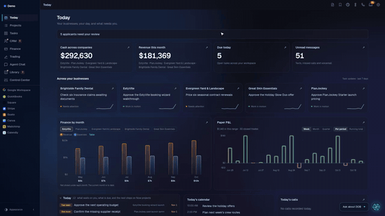
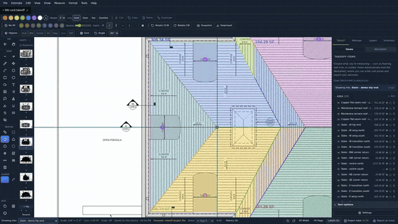
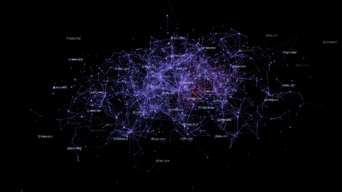

# Brian Atkinson

Builder, operator and founder of [Digital Ops Box](https://www.digitalopsbox.com). More than twenty years in high-end construction, project management and building businesses, with software alongside all of it.

Most of my code is private because it runs real businesses. So here's the work itself. Try it.

---

### Digital Ops Box

One workspace across all your businesses: projects, CRM, calls, email, finance and your agents, on one record.

**[Try the live demo →](https://demo.digitalopsbox.com)**

---

### PlanJockey

Takeoff and estimating for construction drawings, in your browser. Connects to your own agents.

**[Try the demo →](https://www.planjockey.com/demo)**

---

### Signal Box

An instrument that turns sound into a living network of light. One source can fill up to four screens.

**[Play it →](https://signalbox.digitalopsbox.com)**

---

**[See all our work →](https://www.digitalopsbox.com/work)**

Bring me your operational problem: [digitalopsbox.com](https://www.digitalopsbox.com/contact)
